# IT Help Desk Lab: Active Directory & Jira Service Management

## Project Overview

This repository brings together two connected Tier 1 IT Help Desk projects:

1. **[Active Directory & Windows Server](#part-1--active-directory--windows-server)**: building and administering a Windows Server domain in VirtualBox (users, groups, Group Policy, DNS, domain join, password resets, account lockouts).
2. **[Jira Service Management Ticketing](#part-2--it-help-desk-ticketing-with-jira-service-management)**: managing simulated support incidents from ticket creation through resolution.

Together they cover both halves of a help desk role: **doing the technical work** in Active Directory, and **tracking and documenting it** in a ticketing system. For example, the account lockout I triggered and unlocked in Part 1 is the same kind of issue I worked as ticket IT-1 in Part 2.

---

## Part 1 – Active Directory & Windows Server

I built a simulated corporate network consisting of a Windows Server domain controller and a Windows 11 Pro workstation. This part focuses on Active Directory administration, user account management, security groups, Group Policy, DNS, domain authentication, and common Tier 1 IT Help Desk troubleshooting tasks.

### Technologies Used

- Windows Server 2022
- Windows 11 Pro
- Oracle VirtualBox
- Active Directory Domain Services (AD DS)
- DNS
- Group Policy Management
- Active Directory Users and Computers (ADUC)
- Windows Command Prompt

### Lab Environment

| Component | Configuration |
|---|---|
| Domain | `corp.novatech.com` |
| NetBIOS Domain | `CORP` |
| Domain Controller | `CORP-DC01` |
| Windows Client | `CORP-WIN01` |
| Domain Controller IP | `192.168.100.10` |
| Subnet | `192.168.100.0/24` |
| Network | VirtualBox NAT Network (`CorpLab-NAT`) |
| Client Operating System | Windows 11 Pro |

### Lab Implementation

#### 1. Virtual Machine and Server Configuration

Created a Windows Server virtual machine in VirtualBox, configured virtual hardware, established a NAT Network, and installed Windows Server.

Renamed the server `CORP-DC01` and configured a static IPv4 address.

**Server Manager Dashboard**

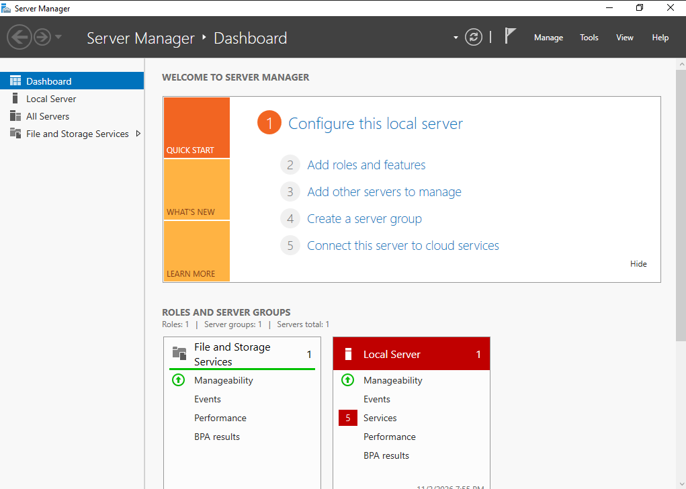

**Static IP Configuration**

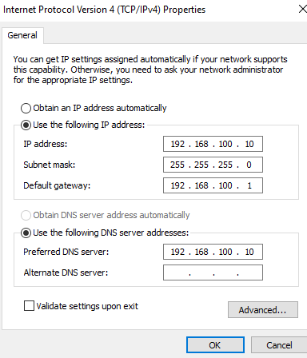

**Network Verification**

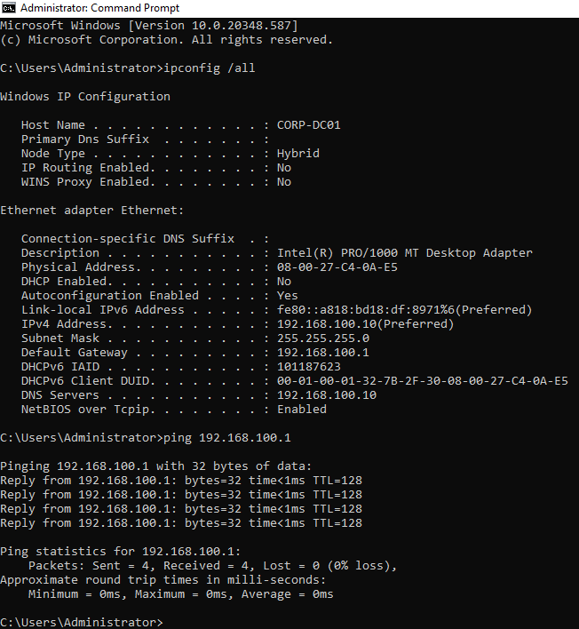

#### 2. Active Directory Domain Services

Installed Active Directory Domain Services and promoted `CORP-DC01` to a domain controller.

Created the Active Directory forest `corp.novatech.com` and configured DNS and Global Catalog services.

**AD DS Installation**

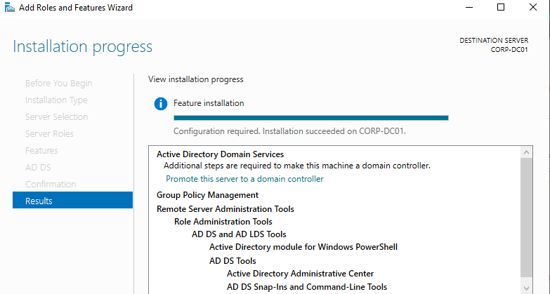

**Domain Configuration**

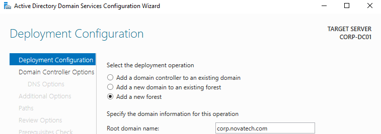

**Active Directory Domain**

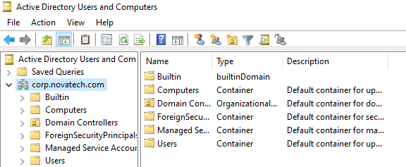

#### 3. Organizational Units and User Administration

Created a Corporate Organizational Unit containing departmental OUs for IT, Human Resources, Finance, Sales, Workstations, and Servers.

Created fictional employee accounts and configured account logon settings.

**Organizational Units**

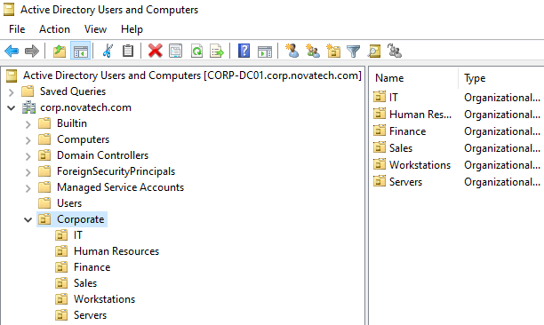

**IT User Accounts**

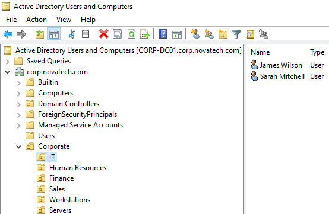

**User Account Properties**

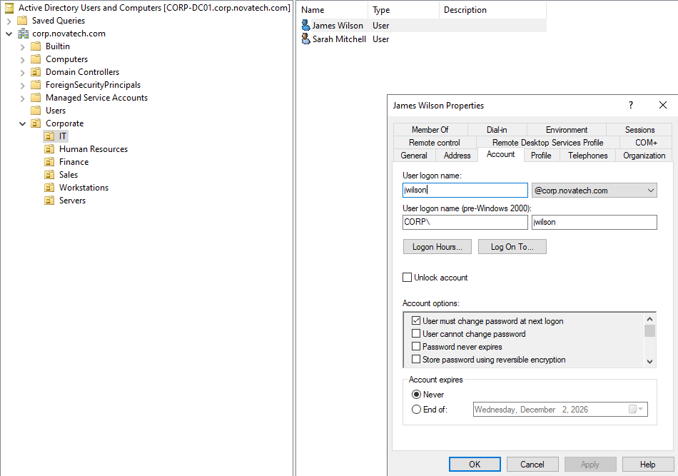

#### 4. Security Group Management

Created departmental global security groups and assigned employees to their corresponding groups.

Practiced managing group membership through Active Directory Users and Computers.

**Security Group**

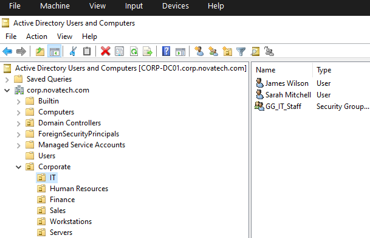

**Group Membership**

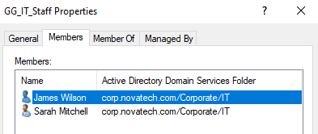

#### 5. Group Policy Configuration

Created and linked a Group Policy Object named `Workstation Security Policy` to the Workstations OU.

Configured a 900-second (15-minute) inactivity limit for domain-joined workstations.

**Group Policy Object**

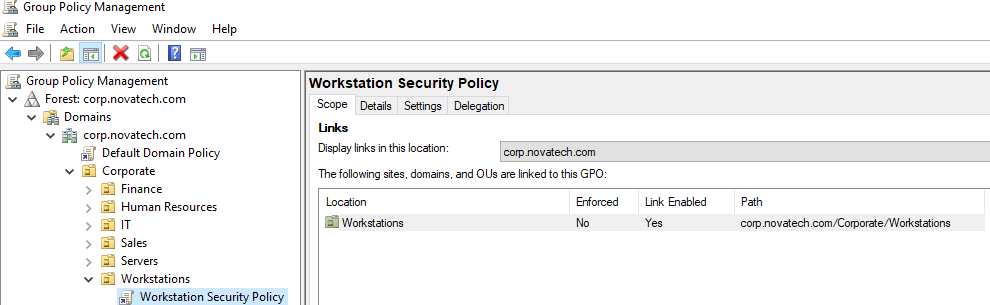

**Security Policy Configuration**

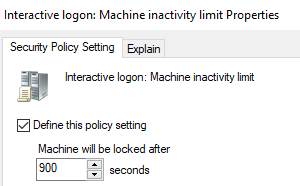

#### 6. Windows Client Domain Integration

Installed Windows 11 Pro on a second VirtualBox VM named `CORP-WIN01`.

Configured the client to use the domain controller for DNS and successfully joined the workstation to `corp.novatech.com`.

Verified Active Directory authentication using a fictional domain user account.

**Windows 11 Client**

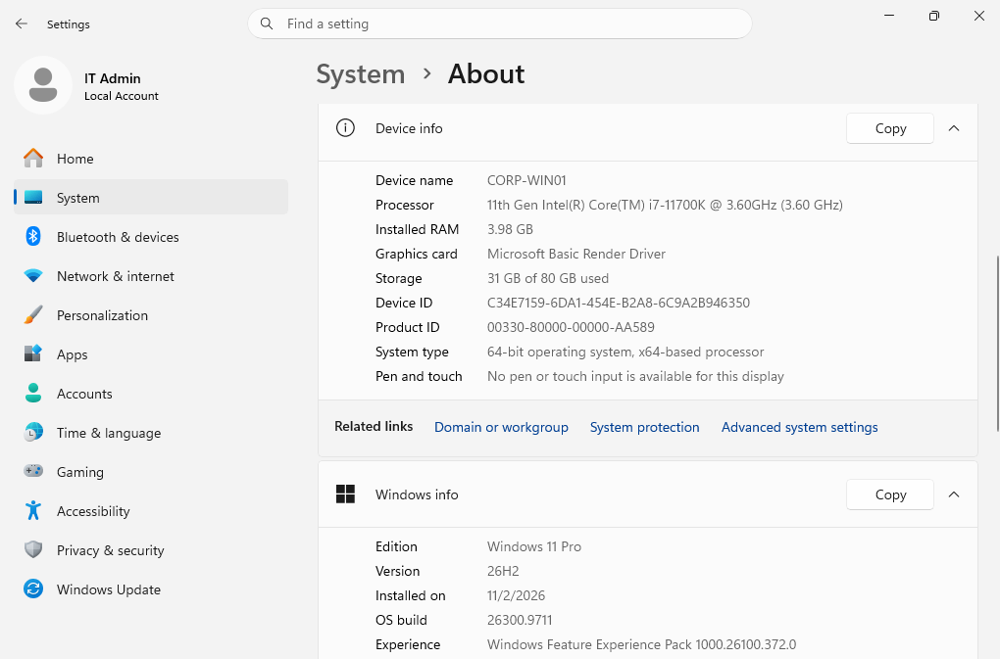

**DNS Configuration**

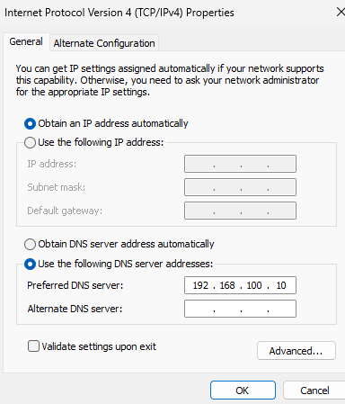

**Domain Controller Discovery**

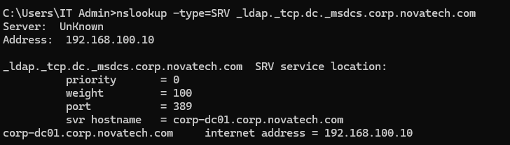

**Domain Membership**

**Domain User Authentication**

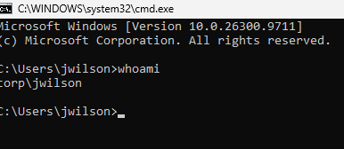

#### 7. Group Policy Verification

Refreshed Group Policy on the domain-joined Windows workstation using:

`gpupdate /force`

Verified the applied Group Policy Objects using:

`gpresult /r /scope computer`

Confirmed that the Workstation Security Policy and Default Domain Policy were successfully applied.

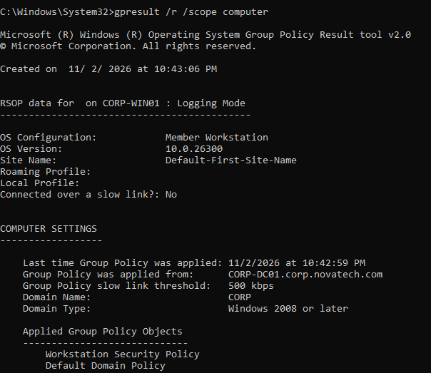

#### 8. Active Directory Password Reset

Simulated a help desk password reset request for a fictional employee.

Reset the employee's password through Active Directory Users and Computers and required a password change at the next logon.

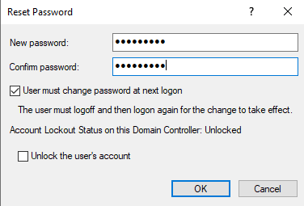

#### 9. Account Lockout and Recovery

Configured an Active Directory account lockout policy with:

- Account lockout threshold: 5 invalid logon attempts
- Lockout duration: 15 minutes
- Reset account lockout counter: 15 minutes

Created a dedicated test account, intentionally triggered an account lockout, and unlocked the account using Active Directory Users and Computers.

Verified successful authentication afterward.

**Account Lockout Policy**

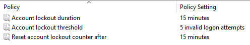

**Test User**

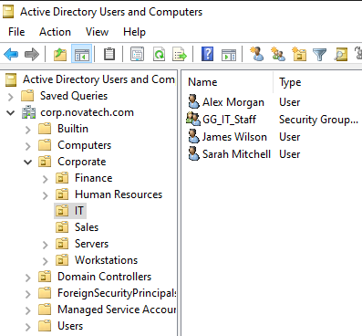

**Account Lockout**

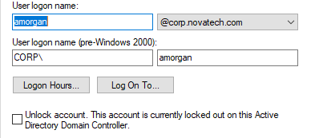

**Account Unlock**

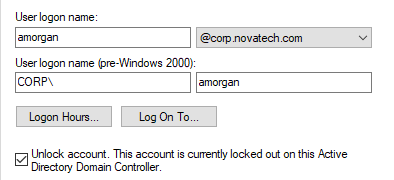

---

## Part 2 – IT Help Desk Ticketing with Jira Service Management

I configured a cloud-based IT service project and managed three simulated support incidents from ticket creation through resolution, focusing on incident tracking, prioritization, ticket assignment, troubleshooting documentation, and service desk workflows.

**Platform:** Jira Service Management  
**Project Type:** IT Support / Incident Management  
**Environment:** Cloud-Based Help Desk Lab

### Project Objectives

- Create and manage IT support tickets using Jira Service Management.
- Assign incidents and track ticket progress.
- Categorize issues by priority, urgency, and impact.
- Document troubleshooting procedures using internal notes.
- Practice resolving and closing support incidents.
- Develop familiarity with enterprise IT service management workflows.

### Support Incidents

#### Incident 1 — Windows Account Lockout (IT-1)

**Problem:** An employee was unable to log in to a Windows workstation following multiple unsuccessful authentication attempts.

**Troubleshooting Plan:** Verify user identity, check account lockout status in Active Directory, investigate failed login attempts, and restore access when authorized.

**Simulated Resolution:** The account was unlocked, and workstation access was restored.

#### Incident 2 — Wi-Fi Connectivity Issue (IT-2)

**Problem:** An employee's Windows laptop could not connect to the company wireless network.

**Troubleshooting Plan:** Inspect wireless adapter settings, check network configuration using `ipconfig /all`, test connectivity with `ping`, and investigate DNS using `nslookup`.

**Simulated Resolution:** The saved wireless network profile was recreated, restoring connectivity.

#### Incident 3 — Network Printer Issue (IT-3)

**Problem:** An employee could not print documents because the network printer appeared offline and print jobs remained queued.

**Troubleshooting Plan:** Check printer connectivity, inspect the Windows print queue, evaluate the Print Spooler service, and verify printer drivers.

**Simulated Resolution:** The print queue was cleared and the Print Spooler service was restarted.

### Ticket Management Workflow

1. Create an incident ticket.
2. Record the reported issue and affected services.
3. Set urgency, impact, and priority.
4. Assign the ticket to a technician.
5. Move the ticket to Work in Progress.
6. Document troubleshooting steps using internal notes.
7. Record a simulated resolution and close the incident.

### Project Screenshots

##### 1. Jira Project Dashboard
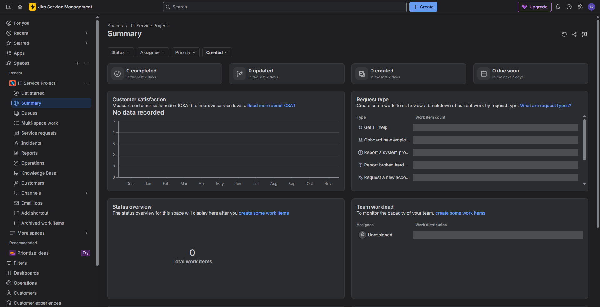

##### 2. Ticket Queue
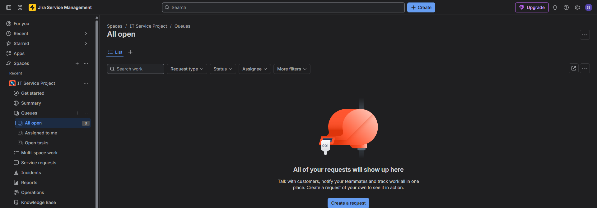

##### 3. Incident Ticket Details
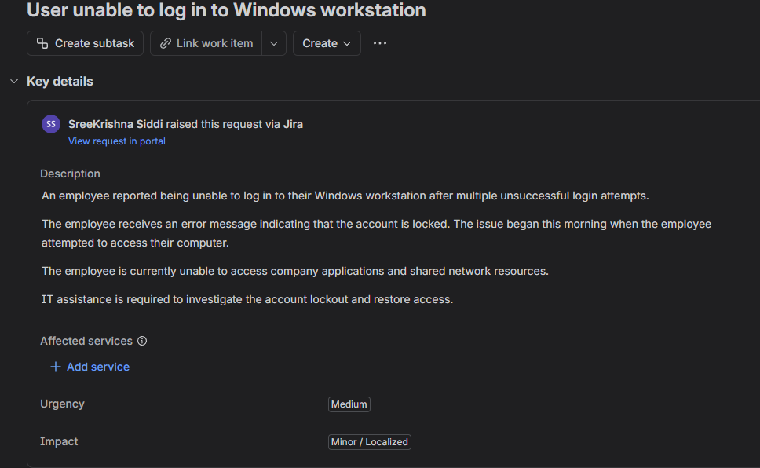

##### 4. Ticket Assignment
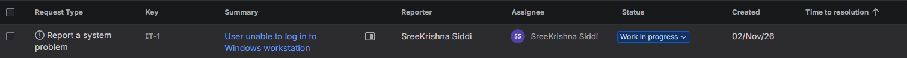

##### 5. Windows Account Troubleshooting
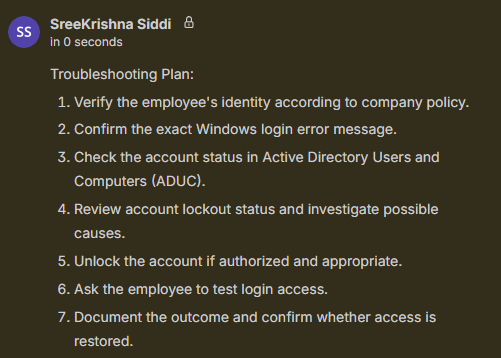

##### 6. Windows Incident Resolution
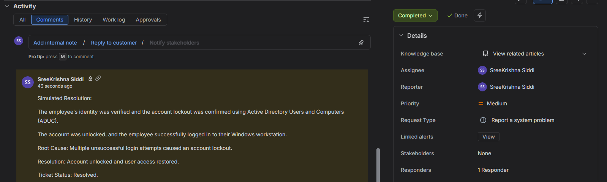

##### 7. Network Connectivity Incident
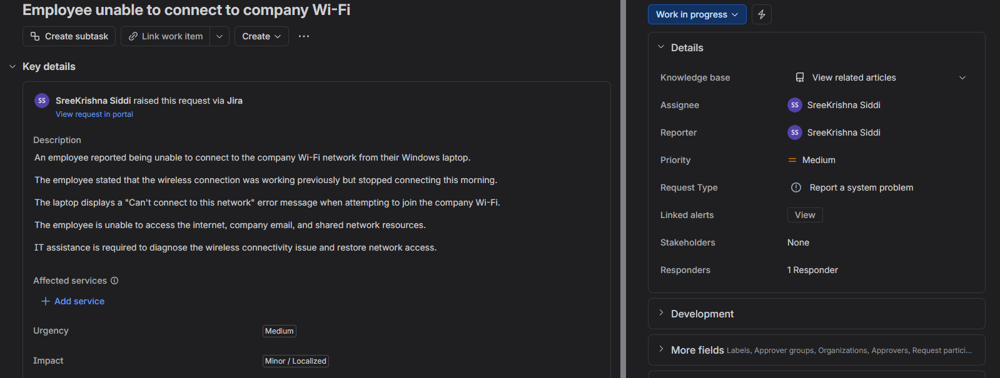

##### 8. Network Troubleshooting
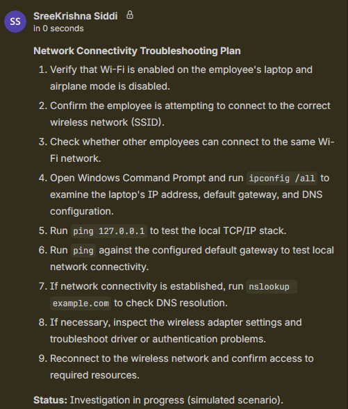

##### 9. Network Incident Resolution
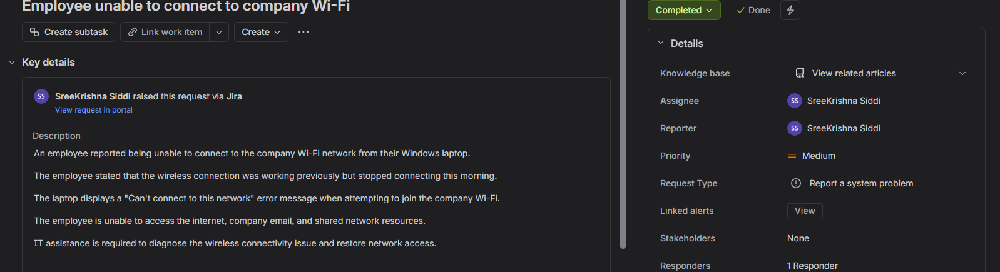

##### 10. Printer Incident

##### 11. Printer Troubleshooting
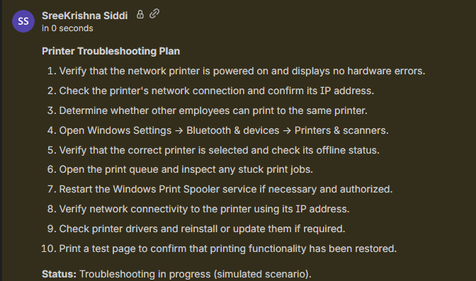

##### 12. Printer Resolution
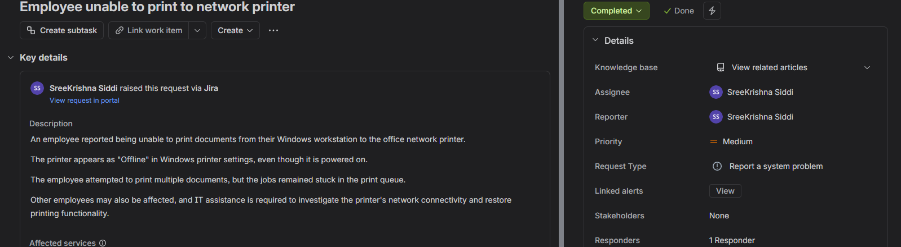

##### 13. Completed Tickets Overview
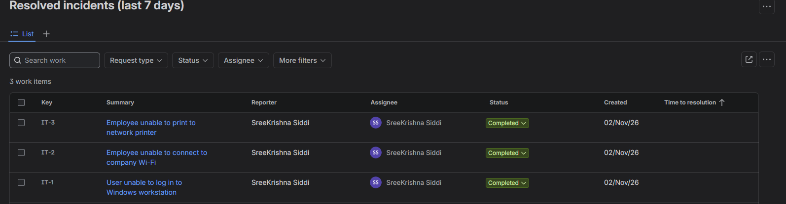

---

## Skills Demonstrated

**Active Directory & Windows Server**
- Windows Server administration and domain controller configuration
- Active Directory Domain Services, OU management, user provisioning
- Security group administration
- Group Policy configuration and verification (`gpupdate`, `gpresult`)
- DNS configuration and troubleshooting
- Windows domain joining and domain user authentication
- Password resets and account lockout troubleshooting
- Virtual machine and network configuration

**Help Desk Ticketing**
- Jira Service Management and IT incident management
- Ticket prioritization (urgency, impact, priority) and assignment
- Troubleshooting documentation with internal notes
- Windows account, network, and printer troubleshooting workflows

## Project Outcome

Deployed and administered a working Active Directory domain in an isolated VirtualBox lab: configured a domain controller, joined a Windows 11 workstation, managed users and security groups, applied Group Policy, and completed password reset and account lockout recovery exercises.

Then created, assigned, tracked, and closed three simulated IT support incidents in Jira Service Management. Technical resolutions in the Jira tickets are documented as simulated scenarios rather than verified changes to production systems.

Together, the projects demonstrate foundational Windows system administration and the ticket-driven workflow of a Tier 1 IT Help Desk.
